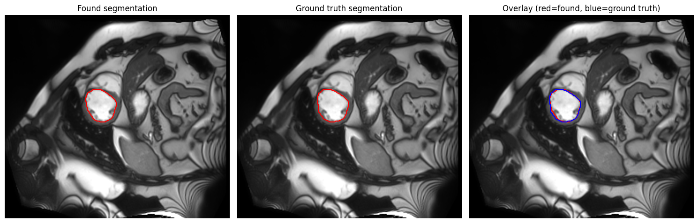

# lv-segmentation-cardiac-mri

Left-ventricle cavity segmentation in short-axis cine MRI (ACDC) with classical image processing only, no deep learning. Image-processing course project (IMA201, Télécom Paris, Oct.-Nov. 2024).



*Patient 042, end-diastole, mid slice. Red: prediction. Blue: manual reference.*

## Results

ACDC, LV cavity. Parameters were set by hand, mainly on ED images.

| Phase | Split | Cases | 2D Dice | 3D Dice |
|---|---|---|---|---|
| ED | training | 100 | 0.907 | 0.932 |
| ED | test | 50 | 0.887 | 0.923 |
| ES | training | 100 | 0.769 | 0.805 |
| ES | test | 50 | 0.709 | 0.738 |

For reference, the best ACDC challenge entry (deep learning) reaches 0.967 (ED) and 0.928 (ES) [1]. Errors concentrate at the apex and the base. Per-slice results are in [`notebooks/01_report.ipynb`](notebooks/01_report.ipynb) (in French). The intermediate report is in [`docs/intermediate_report_fr.pdf`](docs/intermediate_report_fr.pdf) (in French).

## Quick start

Download [ACDC](https://www.creatis.insa-lyon.fr/Challenge/acdc/) into `data/training` and `data/testing` (not redistributed here), then:

```bash
pip install -r requirements.txt
python segment.py data/testing/patient101 --phase ED --output patient101_ED_lv.nii.gz --figure patient101_ED.png
python evaluate.py data/testing --phase ED --output results_testing_ED.csv
```

## Method

- Seed: subtract the normalised ED and ES images, clean with morphology, detect edges with Canny and take the centre of the first Hough circle.
- Region growing: flood fill from the seed with an increasing intensity tolerance. The area jumps when the region leaks through the endocardium, and the mask is taken 10 steps before the largest jump.
- Initial slice: on the ED mid slice, keep the most circular region among all candidate seeds.
- Propagation: seed each neighbouring slice with the centroid of the previous mask, up to the base and down to the apex.
- The iterative region growing is inspired by ITHACA [2].

## Structure

```
lv_segmentation/   seed detection, region growing, pipeline, metrics
notebooks/         report with data analysis and all evaluations
docs/              intermediate report (PDF, French)
figures/           README images
segment.py         segment one case
evaluate.py        evaluate a whole split
```

## References

1. O. Bernard et al. [Deep Learning Techniques for Automatic MRI Cardiac Multi-Structures Segmentation and Diagnosis: Is the Problem Solved?](https://doi.org/10.1109/TMI.2018.2837502). IEEE TMI, 2018.
2. H.-Y. Lee et al. [Automatic Left Ventricle Segmentation Using Iterative Thresholding and an Active Contour Model With Adaptation on Short-Axis Cardiac MRI](https://doi.org/10.1109/TBME.2009.2014545). IEEE TBME, 2010.

## Team

Quentin Revillon and [Benjamin Dupuis](https://github.com/DupuisB), Télécom Paris.
