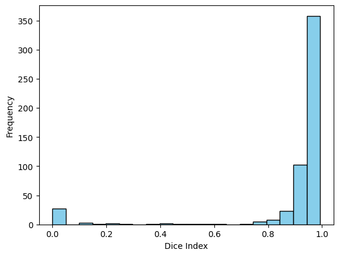
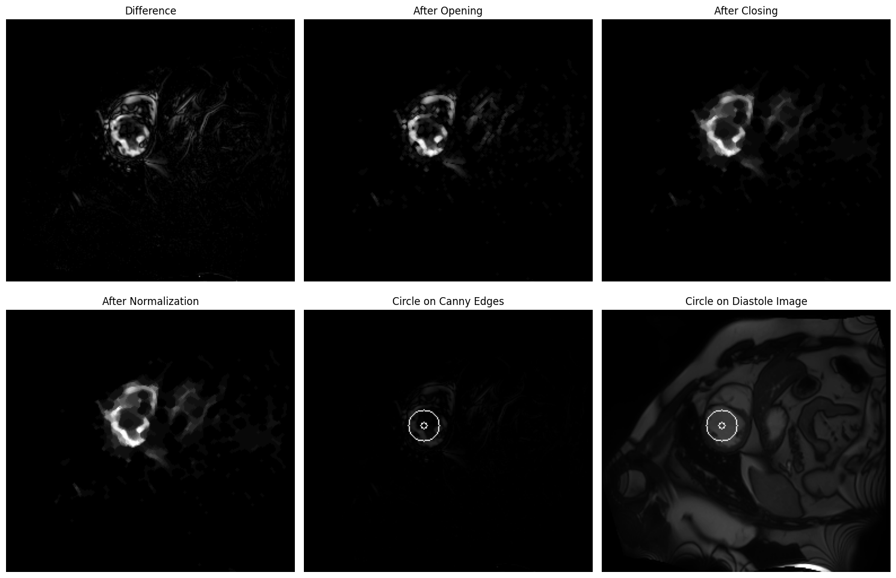
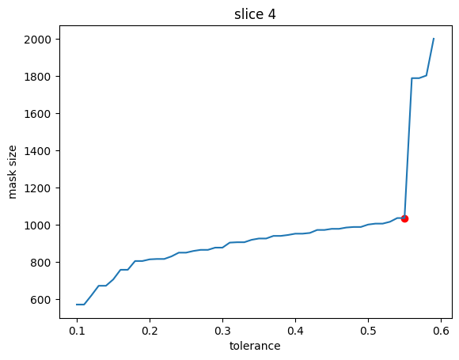

# lv-segmentation-cardiac-mri — left-ventricle segmentation in cine MRI without deep learning

**lv-segmentation-cardiac-mri** segments the left-ventricle (LV) cavity in short-axis cine MRI volumes of the ACDC
dataset with classical image processing only: a Hough-transform seed on the end-diastole/end-systole motion map, then
tolerance-based region growing propagated slice by slice. It needs no training and reaches a 3D Dice of 0.92 at
end-diastole on the 50 ACDC test cases.


*Patient 042, end-diastole, mid slice. Red: predicted contour. Blue: manual reference.*

## Overview

- Problem: delineate the LV cavity in every slice of an end-diastole (ED) or end-systole (ES) cine MRI frame.
- Approach: no learning, unlike the CNNs that lead the ACDC benchmark [1, 2]. A seed is found by circle detection on the ED/ES difference image, a region is grown from it
  until it leaks through the endocardium, and the segmentation is propagated from the mid slice to the base and apex.
  The pipeline follows the endocardial step of ITHACA [3].
- Context: image-processing course project (IMA201, Télécom Paris, Oct.–Nov. 2024), team of two.

## Results

ACDC, LV cavity (label 3). Parameters were tuned by hand on the 100 training cases; the 50 test cases were used for
evaluation only. *2D Dice* is averaged over slices, *3D Dice* over volumes; *Seed in LV* is the share of slices whose
seed falls inside the reference cavity.

| Phase | Split | Cases | Seed in LV | 2D Dice | 3D Dice |
|---|---|---|---|---|---|
| ED | training | 100 | 96.0 % | 0.907 | 0.932 |
| ED | test | 50 | 93.3 % | 0.887 | **0.923** |
| ES | training | 100 | 86.5 % | 0.769 | 0.805 |
| ES | test | 50 | 80.1 % | 0.709 | 0.738 |
| *Best ACDC 2017 entries, deep learning [1]* | *test* | *50* | - | - | *0.967 (ED), 0.928 (ES)* |

On the ED test set, mid-ventricular slices (positions 2 to 6 out of 10) reach a mean 2D Dice of 0.96; errors
concentrate at the apex (0.55) and the base (0.78), where the cavity is small or open. ES is harder: the cavity is
smaller and the parameters were tuned on ED. `evaluate.py` reproduces the two test rows exactly. Per-slice tables and Dice histograms are in
[`notebooks/01_report.ipynb`](notebooks/01_report.ipynb) (in French).



*Distribution of the 2D Dice over all slices of the ED test set.*

## Installation

```bash
conda create -n lv-seg python=3.12 -y && conda activate lv-seg
pip install -r requirements.txt
```

The notebook additionally needs `pip install jupyter plotly tqdm`.

## Quick start

Download ACDC into `data/` (see [Data](#data)), then segment one case:

```bash
python segment.py data/testing/patient101 --phase ED --output patient101_ED_lv.nii.gz --figure patient101_ED.png
```

| Output | Content |
|---|---|
| `patient101_ED_lv.nii.gz` | LV cavity mask (uint8, 1 = LV), same geometry as `patient101_frame01.nii.gz` |
| `patient101_ED.png` | mid slice with predicted (red) and reference (blue) contours (optional) |

Evaluate on a whole split (a few seconds per case on a CPU):

```bash
python evaluate.py data/testing --phase ED --output results_testing_ED.csv
```

`--phase` is `ED` or `ES`; `--limit 3` restricts the run to the first 3 cases.

## Repository structure

- `lv_segmentation/data.py`: load an ACDC case (ED/ES frame read from `Info.cfg`), intensity normalisation.
- `lv_segmentation/seed.py`: motion map, morphological cleaning, Canny edges, Hough circle seed.
- `lv_segmentation/growing.py`: region growing (`grow_to_size`, `grow_until_jump`), circularity, centroid.
- `lv_segmentation/pipeline.py`: initial seed selection and slice-to-slice propagation.
- `lv_segmentation/metrics.py`: Dice coefficient, seed-in-LV check.
- `segment.py`, `evaluate.py`: command-line entry points.
- `notebooks/01_report.ipynb`: final report with data analysis, intermediate figures and all evaluations.
- `figures/`: images used in this README.

## Method

**1. Seed detection.** The LV cavity is the most circular structure of a short-axis slice and its walls move the most
during the cardiac cycle. For each slice, the ED and ES images are normalised (0.1–99.9 percentiles) and subtracted.
The difference is cleaned by a 3x3 opening and a 7x7 closing, edges are extracted with Canny, and the centre of the
first circle found by the Hough transform (radius 8–15 px, or 15–30 px for images wider than 400 px) is the seed.



**2. Region growing.** Starting from the brightest pixel in an 11x11 window around the seed, a flood fill accepts
neighbours whose intensity is within `tolerance * I(seed)`, and the region is replaced by its convex hull. The
tolerance is raised by steps of 0.01 until the region exceeds 3000 px. When the region leaks through the endocardium
into the myocardium or the right ventricle, its area jumps; the segmentation is the region obtained 10 steps before the
largest jump in the second half of the area curve. Areas are capped at 2000 px (1000 px near the apex), so the largest
jump is the first leak rather than a later, larger one.



**3. Initial seed and propagation.** On the ED mid slice, a region is grown from the seed of every slice (fixed target
area of 1600 px) and the most circular one (4πA/P²) is kept; its centroid is the initial seed. The mid slice of the
requested phase is segmented from it, then each neighbouring slice is seeded with the centroid of the previous mask, up
to the base and down to the apex.

Explored in the notebook and not retained: Fourier analysis and pixel-wise temporal variance for the motion map,
fixed-threshold and circularity-based stopping rules, and the energy-based seed propagation of [3]. For comparison, a
U-Net with an ImageNet-pretrained ResNet-34 encoder trained for 5 epochs on ED images reached a Dice of 0.88 (report
conclusion; this code is not part of the repository).

## Data

[ACDC](https://www.creatis.insa-lyon.fr/Challenge/acdc/) (Automated Cardiac Diagnosis Challenge, MICCAI 2017):
150 patients (100 training, 50 test), cine MRI with manual ED and ES labels. It is free for non-commercial research
under CC BY-NC-SA 4.0 and is not redistributed here. Expected layout:

```
data/
├── training/
│   └── patient001/ ... patient100/
└── testing/
    └── patient101/ ... patient150/
        ├── Info.cfg                      # ED and ES frame numbers
        ├── patient101_frame01.nii.gz
        ├── patient101_frame01_gt.nii.gz
        ├── patient101_frame14.nii.gz
        └── patient101_frame14_gt.nii.gz
```

## References

1. O. Bernard, A. Lalande, C. Zotti, F. Cervenansky et al. "Deep Learning Techniques for Automatic MRI Cardiac
   Multi-structures Segmentation and Diagnosis: Is the Problem Solved?" *IEEE Transactions on Medical Imaging*,
   37(11):2514–2525, 2018. [doi:10.1109/TMI.2018.2837502](https://doi.org/10.1109/TMI.2018.2837502)
2. M. Khened, V. A. Kollerathu, G. Krishnamurthi. "Fully convolutional multi-scale residual DenseNets for cardiac
   segmentation and automated cardiac diagnosis using ensemble of classifiers." *Medical Image Analysis*, 51:21–45,
   2019. [doi:10.1016/j.media.2018.10.004](https://doi.org/10.1016/j.media.2018.10.004)
3. H.-Y. Lee, N. C. F. Codella, M. D. Cham, J. W. Weinsaft, Y. Wang. "Automatic Left Ventricle Segmentation Using
   Iterative Thresholding and an Active Contour Model With Adaptation on Short-Axis Cardiac MRI." *IEEE Transactions
   on Biomedical Engineering*, 57(4):905–913, 2010. [doi:10.1109/TBME.2009.2014545](https://doi.org/10.1109/TBME.2009.2014545)

## Team

Quentin Revillon and [Benjamin Dupuis](https://github.com/DupuisB), Télécom Paris.
