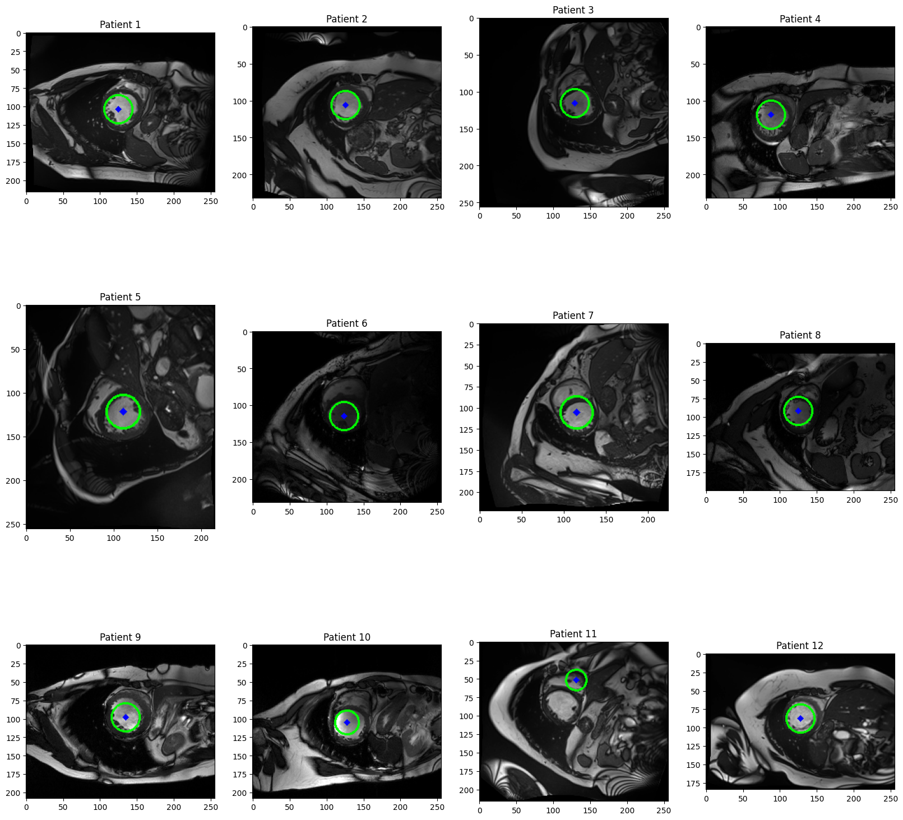

# Segmentation d'IRM du coeur: rendu intermédiaire
*par **Quentin Révillon, Benjamin Dupuis***

## Présentation du projet:
En se basant sur des techniques d'analyse d'image traditionnelle, et par opposition aux approches plus récente de Deep-Learning (type CNN), l'objectif de notre projet est de fournir une méthode de segmentation du ventricule gauche du coeur sur des images IRM. Cette méthode doit être robuste, précise et rapide.

## Plannification:
Pour mener à bien ce projet, nous avons décidé de nous concentrer sur l'algorithme de segmentation par croissance de région. Nous avons défini les étapes suivantes:
1. **Prétraitement des images**: normalisation, filtrage, etc.
2. **Identification d'un *seed point***: point initial proche du centre du ventricule.
3. **Segmentation par croissance de région**: à partir du *seed point*, on agrandit la région selon des conditions à définir.

Notre objectif est d'obtenir une base fonctionnelle (même si elle n'est pas optimale) pour toutes ces étapes et d'ensuite chercher à les améliorer individuellement. 

## Bilan intermédiaire:
Pour l'instant, voici le détail des tâches que nous avons réalisées:
- **Prévisualisation et familiarisation avec les données**: nous avons découvert le jeu de données, visualisé les images IRM et les masques associés. Nous avons également analysé la distribution du jeu de données. Une version épuré du travail réalisé peut-être trouvé [ici](https://github.com/quentin-lab/IMA_proj1/blob/main/visualisation.ipynb).

- **Prétraitement des images**: cet étape dépend beaucoup des algorithmes utilisés dans les étapes 2 et 3. Il est donc difficile de donner les étapes précises. Une normalisation des images semble cependant nécéssaire si l'on veut comparer les intensités des pixels.

- **Identification d'un *seed point***: Pour cette étape, nous avons choisi d'étudier deux approches concurrentes:
    - **Détection de cercle**: le centre du ventricule gauche est approximativement le seul vrai cercle de l'image, on peut donc utiliser un algorithme de détection de cercle (ici **détection de bord par un filtre de Canny** puis **transformée de Hough**) pour trouver le "meilleur" cercle et choisir son centre comme *seed point*.
    - **Analyse fréquentielle**: le coeur est approximativement la seule structure des images à varier rapidement en intensité. On peut donc utiliser une transformée de Fourier pour identifier les fréquences dominantes et filtrer les zones à variation rapide. Une **détéction de cercle** peut ensuite être appliquée sur cette zone réduite.

    Au final, l'algorithme de détection de cercle nous fournit de meilleur résultats. Cela peut-être dû à une mauvaise implémentation de l'analyse fréquentielle, et nous avons des idées pour l'améliorer. Les résulats ne sont pas parfaits, mais ils sont suffisamment bons pour une première itération.

    ***Exemples de détection de cercle***:

    Voici les exemples sur les 12 premiers patients:
    
    

- **Segmentation par croissance de région**:
    - Nous avons commencé par des algorithme de croissance de région basique:
        - **Croissance de région par bord**: on réalise une détéction de bord (ici par un filtre de Canny) et on ajoute les voisins qui ne touchent pas le bord (et qui touchent le bord).
        - **Croissance de région par seuil**: on choisit un seuil de départ et on ajoute les voisins qui ont une intensité proche du seuil.
        - **Croissance de région par moyenne**: on choisit un seuil de départ et on ajoute les voisins qui ont une intensité proche de la moyenne de la région.
    
        Malheureusement, ces algorithmes ne donnent pas de résultats satisfaisants. Nous nous penchons alors sur des algorithmes plus complexes.

## Prochaines étapes:

- Notre priorité actuelle est de **trouver un algorithme de *region growing* qui fonctionne correctement**. Pour cela, nous allons essayer des approches plus avancées.
- Une fois cette étape réalisée, nous pourrons nous concentrer sur l'optimisation des différentes étapes et sur l'amélioration de la robustesse et des performances de notre méthode.